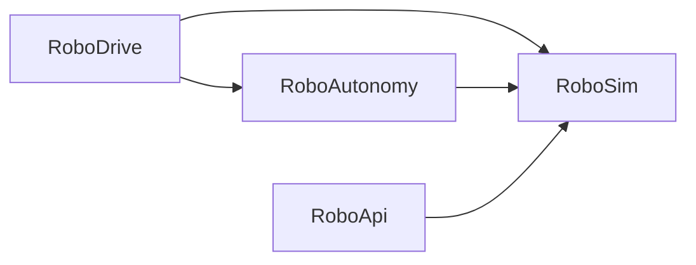
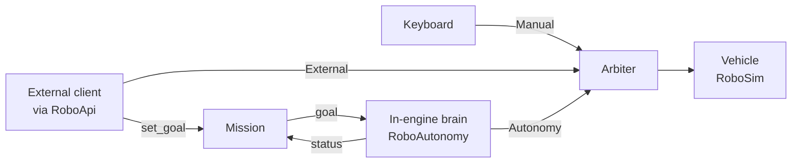

# RoboDrive

[](https://github.com/JoelAbe/RoboDrive/actions/workflows/simulation-tests.yml)

A ground-robot simulation built in Unreal Engine 5.8. Not a game: a simulation
platform with real differential-drive kinematics, sensor models with
configurable noise, an external API, and a scenario test suite that runs in CI.

> **Status:** Phase 4 complete, Phase 5 in progress. The robot drives from velocity commands
> through real differential drive kinematics on Chaos physics, carries wheel
> encoders, an IMU, a lidar and a camera on a simulated clock, and estimates
> its own pose by dead reckoning. An external TCP API lets
> any client drive and observe it, scenarios are defined as JSON, and every
> push runs the full scenario suite in CI. The robot drives itself to a goal,
> steering around obstacles its lidar sees, and fails in fog for a measured,
> documented reason. An operator view shows what it is doing and why, with
> manual and automatic modes and an emergency stop. See the
> [roadmap](docs/roadmap.md).

## Requirements

- Unreal Engine 5.8
- Windows, with Visual Studio 2022 ("Game development with C++") or JetBrains Rider
- PowerShell 7, for the scripts in `Tools/`
- Python 3.10 or newer. The API client and scenario harness use only the
  standard library; the run analysis also needs `pandas` and `matplotlib`
  (`pip install -r Tools/Analysis/requirements.txt`).

## Build

Right-click `RoboDrive.uproject` and choose **Generate Visual Studio project
files**, then build the `RoboDriveEditor` target in `Development Editor | Win64`.
Rider can open `RoboDrive.uproject` directly.

## Tests

There are two layers of tests, and CI runs both.

**Unit tests** are C++ automation tests covering the maths that does not need a
running world: frame conversions, kinematics, suspension and traction, the
arbiter, the clock, odometry, the encoder, noise, the IMU, lidar geometry, the
run file format, the brains and obstacle avoidance.

```powershell
./Tools/RunTests.ps1                                    # build, then run all tests
./Tools/RunTests.ps1 -SkipBuild                         # use the existing build
./Tools/RunTests.ps1 -Filter RoboDrive.RoboSim.Frames   # run a subset
```

Close the editor first; the build step cannot run while Live Coding is active.
A filter that matches no tests is treated as a failure rather than a pass.
Inside the editor, the same tests are under **Tools → Test Automation**.

**Scenario tests** launch the simulation headless, load each scenario in
`Scenarios/` through the external API, let the robot's in-engine brain drive
to the goal, and judge the result against ground truth. Headless runs use a
fixed time step and run about 12 times faster than real time, with the same
results.
([ADR 0012](docs/decisions/0012-headless-runs-on-a-fixed-time-step.md))

```powershell
./Tools/RunScenarios.ps1                                         # the scenario suite
./Tools/RunScenarios.ps1 -Script Tools\Analysis\fog_sweep.py     # any script, headless
```

Both scripts exit 0 on success and 1 on failure. Every push to `main` runs
both in [continuous integration](docs/ci.md).

## Architecture

The C++ code is split into four modules. An arrow means "depends on":



| Module | Responsibility |
|---|---|
| `RoboSim` | The simulation: vehicle, sensors, odometry, clock, recording and replay. Knows nothing about what is driving it. |
| `RoboAutonomy` | The in-engine brains, go-to-goal and lidar obstacle avoidance: read a sensor snapshot, produce drive commands. |
| `RoboApi` | The external API: a TCP server through which any client can drive and observe the simulation. |
| `RoboDrive` | The game module: keyboard input, game mode and the operator view. |

The build enforces that direction. `RoboSim` cannot include headers from any of
the other three, which keeps the simulation independent of whatever drives it,
whether that is a keyboard, an in-engine controller, a test script or an
external ROS 2 stack.
([ADR 0001](docs/decisions/0001-three-module-split.md),
[ADR 0007](docs/decisions/0007-external-api-module.md))

That diagram shows who is allowed to *know about* whom. Data travels
differently. `RoboApi` and `RoboAutonomy` never reference each other, yet a goal
sent through the API reaches the in-engine brain, because both meet at shared
points inside `RoboSim`: the **mission**, which holds the current goal, and the
**arbiter**, which every command source submits to.



The API is a door for brains outside the engine, a peer of the in-engine
autonomy rather than a layer in front of it. Neither needs to know the other
exists, much as ROS nodes share a topic without referencing each other.
Brains are handed a snapshot of the robot's sensors rather than the robot
itself, so they have no route to ground truth.
([ADR 0009](docs/decisions/0009-brains-receive-a-snapshot.md))

The default brain steers around obstacles by searching each lidar scan for the
clear heading closest to the goal, and reports the mission failed, rather than
pretending to arrive, when it is boxed in.
([ADR 0010](docs/decisions/0010-reactive-obstacle-avoidance.md))

Every command source goes through one arbiter, which picks the highest-priority
source with a fresh command and stops the robot if none is fresh. Manual input
always wins, and a source that stops sending stops driving.
([ADR 0005](docs/decisions/0005-arbitration-by-priority-and-freshness.md))

The robotics code works in ROS REP-103 conventions: metres, radians, and +Y to
the left. Unreal's centimetres and +Y-right frame appear only at the boundary,
in [`RoboFrames.h`](Source/RoboSim/Public/RoboFrames.h). This is what lets
published formulas be used as written.
([ADR 0002](docs/decisions/0002-rep103-internal-frames.md))

All design decisions are recorded in [docs/decisions](docs/decisions/README.md).

## Operator view

While playing, panels over the game view show who is driving, command against
actual motion, what the brain is doing and why, the mission, the sensor
conditions, and, set apart, how far the robot's belief has drifted from the
truth. Scenarios can be picked from the `Scenarios/` folder and restarted, and
the brain, avoidance and weather tuned, without the editor. **1** and **2**
switch between automatic and manual driving, **Space** is an emergency stop,
**R** restarts the scenario, and **Tab** hides the panels. See
[the operator view](docs/operator-view.md).
([ADR 0013](docs/decisions/0013-operator-modes-and-emergency-stop.md),
[ADR 0014](docs/decisions/0014-operator-view-in-slate.md),
[ADR 0015](docs/decisions/0015-scenario-loading-in-the-simulation.md))

## External API

While the simulation is playing it listens on `127.0.0.1:8765` for
newline-delimited JSON. A client can load a scenario, send drive commands,
advance the simulation, and read sensors and ground truth separately. The
[API reference](docs/api.md) lists every operation.

```python
from robodrive_client import SimClient

with SimClient() as client:
    client.call("reset")
    client.call("set_command", v=0.5, w=0.0)
    client.call("step", steps=12)
    print(client.call("get_sensors", include_lidar=False))
```

## Scenarios

Scenarios are JSON files describing a start, obstacles, a goal and a time
limit, written without Unreal and reviewable in a diff. The
[scenario format](docs/scenarios.md) explains them.
([ADR 0008](docs/decisions/0008-scenarios-as-data.md))

## Measurements

- [Odometry drift](docs/odometry-drift.md) — how calibration error, encoder
  noise and wheel slip each show up, measured against ground truth.
- [Lidar profiling](docs/profiling-lidar.md) — sensor cost against ray count,
  and the measured real-time ceiling.
- [Fog](docs/fog.md) — how fog defeats the obstacle avoidance: not by
  shortening the lidar's range, but by clutter that makes the steering jitter,
  the wheels slip and odometry claim arrival at a goal not reached.

## Layout

```
Source/
  RoboSim/            simulation layer
  RoboAutonomy/       in-engine autonomy
  RoboApi/            external TCP API
  RoboDrive/          game module
Content/              level, Blueprints and input assets
Config/               project settings (edited through the editor)
Scenarios/            scenario files for the test suite
Tools/
  RunTests.ps1        build and run the unit tests
  RunScenarios.ps1    run the scenario suite headless
  Analysis/           Python: API client, scenario harness, run analysis
docs/                 roadmap, references, measurements and decision records
.github/workflows/    CI
```

## License

MIT, see [LICENSE](LICENSE). Unreal Engine itself is covered by Epic's own
licence terms, which this project does not alter or redistribute.
