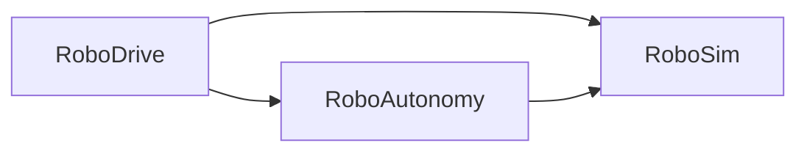

# RoboDrive

A ground-robot simulation built in Unreal Engine 5.8. Not a game: a
simulation platform with real differential-drive kinematics, sensor models
with configurable noise, and a test harness that runs without the editor.

> **Status:** Phase 0, foundations. The module structure, coordinate frame
> conversions and headless test runner exist; nothing drives yet.
> See the [roadmap](docs/roadmap.md).

## Requirements

- Unreal Engine 5.8
- Windows, with Visual Studio 2022 (Game development with C++) or JetBrains Rider
- PowerShell 7, for the scripts in `Tools/`

## Build

Right-click `RoboDrive.uproject` and choose **Generate Visual Studio project
files**, then build the `RoboDriveEditor` target in `Development Editor | Win64`.
Rider can also open `RoboDrive.uproject` directly.

## Tests

```powershell
./Tools/RunTests.ps1                                    # build, then run all tests
./Tools/RunTests.ps1 -SkipBuild                         # use the existing build
./Tools/RunTests.ps1 -Filter RoboDrive.RoboSim.Frames   # run a subset
```

Close the editor first; the build step cannot run while Live Coding is
active. The script exits non-zero if any test fails, or if no tests match
the filter.

In the editor, tests are under **Tools → Test Automation → RoboDrive**.

## Architecture

The C++ code is split into three modules. An arrow means "depends on":



| Module | Responsibility |
|---|---|
| `RoboSim` | The simulation: vehicle, sensors, odometry. Knows nothing about what is driving it. |
| `RoboAutonomy` | The in-engine brain: reads sensor data, produces drive commands. |
| `RoboDrive` | The game module: connects a brain to a robot, handles input and UI. |

The build enforces the direction: `RoboSim` cannot include headers from the
other two, which keeps the simulation independent of whatever drives it.
([ADR 0001](docs/decisions/0001-three-module-split.md))

The robotics code uses ROS REP-103 conventions (metres, radians, +Y to the
left). Unreal's centimetres and +Y-right frame appear only at the boundary,
in [`RoboFrames.h`](Source/RoboSim/Public/RoboFrames.h).
([ADR 0002](docs/decisions/0002-rep103-internal-frames.md))

## Layout

```
Source/
  RoboSim/        simulation layer
  RoboAutonomy/   in-engine autonomy
  RoboDrive/      game module
Config/           project settings (edited through the editor)
Tools/            scripts
docs/             roadmap and design decisions
```