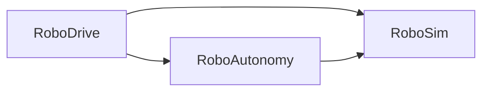

# RoboDrive

A ground-robot simulation built in Unreal Engine 5.8. Not a game: a simulation
platform with real differential-drive kinematics, sensor models with
configurable noise, and a test harness that runs without the editor.

> **Status:** Phase 2 complete. The robot drives from velocity commands
> through real differential drive kinematics on Chaos physics, carries wheel
> encoders, an IMU, a lidar and a camera on a simulated clock, and estimates
> its own pose by dead reckoning. Runs are recorded to CSV, replayed, and
> analysed in Python. Next is an external API and data-driven scenarios.
> See the [roadmap](docs/roadmap.md).

## Requirements

- Unreal Engine 5.8
- Windows, with Visual Studio 2022 ("Game development with C++") or JetBrains Rider
- PowerShell 7, for the scripts in `Tools/`

## Build

Right-click `RoboDrive.uproject` and choose **Generate Visual Studio project
files**, then build the `RoboDriveEditor` target in `Development Editor | Win64`.
Rider can open `RoboDrive.uproject` directly.

## Tests

```powershell
./Tools/RunTests.ps1                                    # build, then run all tests
./Tools/RunTests.ps1 -SkipBuild                         # use the existing build
./Tools/RunTests.ps1 -Filter RoboDrive.RoboSim.Frames   # run a subset
```

Close the editor first; the build step cannot run while Live Coding is active.
The script exits non-zero if any test fails, or if no tests match the filter —
a filter that matches nothing is treated as a failure rather than a pass.

Inside the editor, the same tests are under **Tools → Test Automation**, listed
under `RoboDrive`.

## Architecture

The C++ code is split into three modules. An arrow means "depends on":



| Module | Responsibility |
|---|---|
| `RoboSim` | The simulation: vehicle, sensors, odometry. Knows nothing about what is driving it. |
| `RoboAutonomy` | The in-engine brain: reads sensor data, produces drive commands. |
| `RoboDrive` | The game module: connects a brain to a robot, and handles input and UI. |

The build enforces that direction — `RoboSim` cannot include headers from the
other two — which keeps the simulation independent of whatever drives it,
whether that is a keyboard, an in-engine controller, a test script or an
external ROS 2 stack.
([ADR 0001](docs/decisions/0001-three-module-split.md))

The robotics code works in ROS REP-103 conventions: metres, radians, and +Y to
the left. Unreal's centimetres and +Y-right frame appear only at the boundary,
in [`RoboFrames.h`](Source/RoboSim/Public/RoboFrames.h). This is what lets
published formulas be used as written.
([ADR 0002](docs/decisions/0002-rep103-internal-frames.md))

## Measurements

- [Odometry drift](docs/odometry-drift.md) — how calibration error, encoder
  noise and wheel slip each show up, measured against ground truth.
- [Lidar profiling](docs/profiling-lidar.md) — sensor cost against ray count,
  and the measured real-time ceiling.

## Layout

```
Source/
  RoboSim/        simulation layer
  RoboAutonomy/   in-engine autonomy
  RoboDrive/      game module
Config/           project settings (edited through the editor)
Tools/            scripts
docs/             roadmap and architecture decision records
```

## License

MIT, see [LICENSE](LICENSE). Unreal Engine itself is covered by Epic's own
licence terms, which this project does not alter or redistribute.
