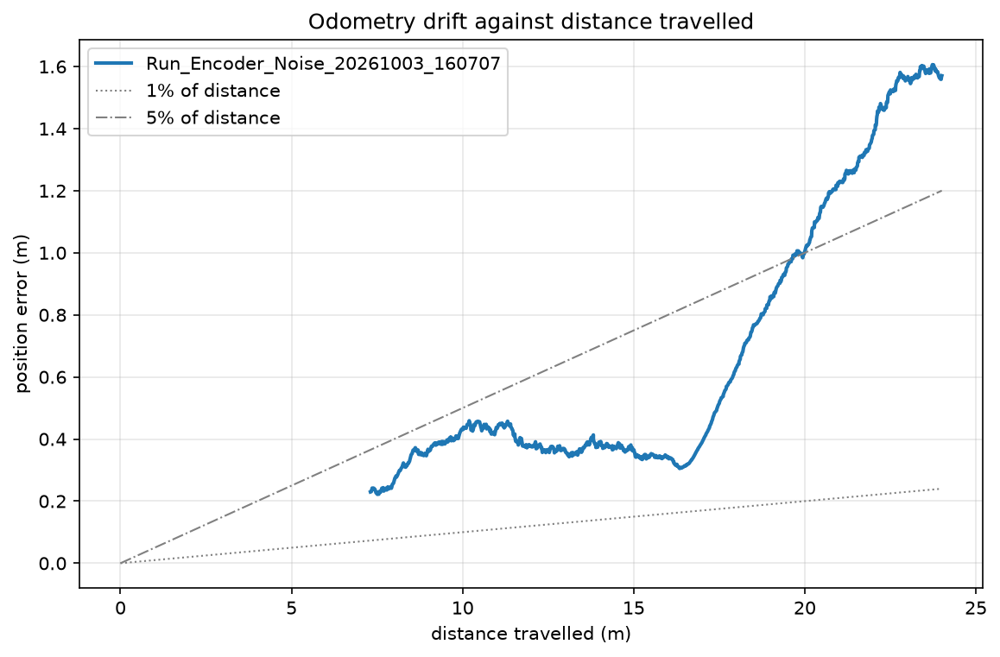
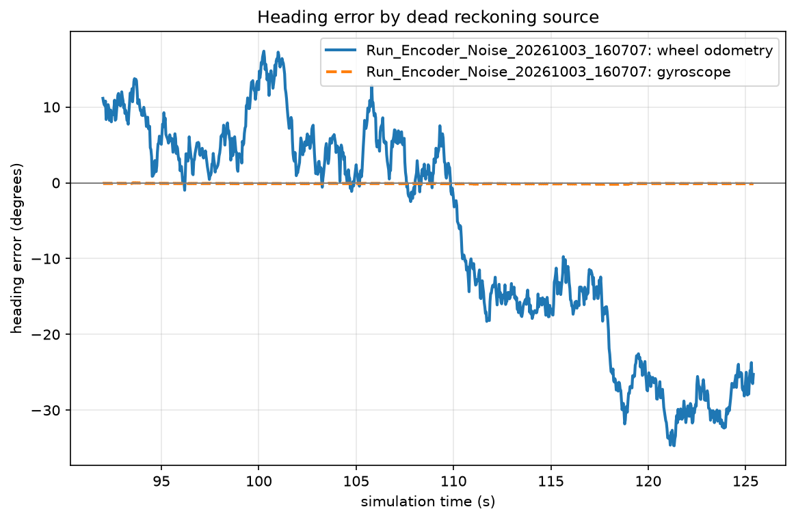

# Measuring odometry drift

Wheel odometry estimates pose by integrating wheel rotation. It never consults
the world, so every error stays in the estimate permanently. These runs
measure how different kinds of error behave, using the simulation's ground
truth as the reference.

Each run was driven by the stub autonomy at 0.5 m/s around a 2 m radius, so
the path is identical and the only variable is the one named. Runs are
recorded at 50 Hz to CSV and analysed with `Tools/analysis/analyse_run.py`.

## Results

| Run | Distance | Final error | % of distance | Odometry heading error | Gyro heading error |
|---|---|---|---|---|---|
| Baseline | 25.3 m | 0.009 m | **0.04%** | 0.3° | 0.0° |
| Wheel radius +2% | 28.6 m | 0.426 m | **1.49%** | 11.6° | 0.0° |
| Encoder noise, sigma 3 rad/s | 24.0 m | 1.570 m | **6.54%** | −25.3° | −0.1° |
| Slip event (manual driving) | 21.3 m | 1.290 m | **6.06%** | 7.0° | −1.1° |



## What each run shows

**Baseline: 0.04% of distance.** With no injected error the estimate tracks
truth almost exactly, which establishes that the integrator and the kinematics
are not themselves a source of drift. Real indoor robots typically manage
1–5%, so the floor here is set by the model rather than by anything physical.

**Wheel radius error: a steady climb.** Believing the wheel is 2% larger than
it is scales every measurement by the same factor, so the error grows with
distance and never averages out. Note that it reads 1.49% rather than 2%: on a
*circular* path a scale error inflates the estimated circle rather than
marching away in a straight line, so part of it returns each lap. On a
straight path the same error would show the full 2%. The shape of the path
changes how a calibration error presents, which is worth knowing before
quoting a single number for "odometry accuracy".

**Encoder noise: a random walk.** Noise of this size (sigma 3 rad/s against a
wheel turning at roughly 5 rad/s) is deliberately exaggerated. The estimate
wanders either side of truth rather than sliding one way, and the error grows
roughly with the square root of distance rather than linearly.

**Slip: a step, not a drift.** During manual driving a spin was commanded while
the robot was still travelling at 2 m/s. The wheels were commanded to
counter-rotate, the encoders counted that rotation, and the robot physically
did not turn for about 0.4 seconds because the wheels had no grip left to
deliver yaw torque. Odometry gained 17° of heading in that moment and never
recovered it.

## The finding that matters

**The gyroscope stayed within 0.2° on every clean run, and within 1.4° during
the slip event, while wheel odometry lost up to 25°.**

The two sources fail in different places. Encoders measure the wheels, so they
see slip as motion that never happened. The gyroscope measures the body, so
slip is invisible to it — but it has no position information at all and its
own bias integrates without bound.



That is the argument for fusing them, measured rather than asserted, and it is
why the next layer of a real robot is localisation rather than better encoders.

## Reproducing

```
python Tools/analysis/analyse_run.py Saved/RoboDrive/Runs/*.csv --out docs/images
```

Each CSV carries the settings that produced it in comment lines above the
data: sample rates, noise sigma, calibration factors and random seeds.
